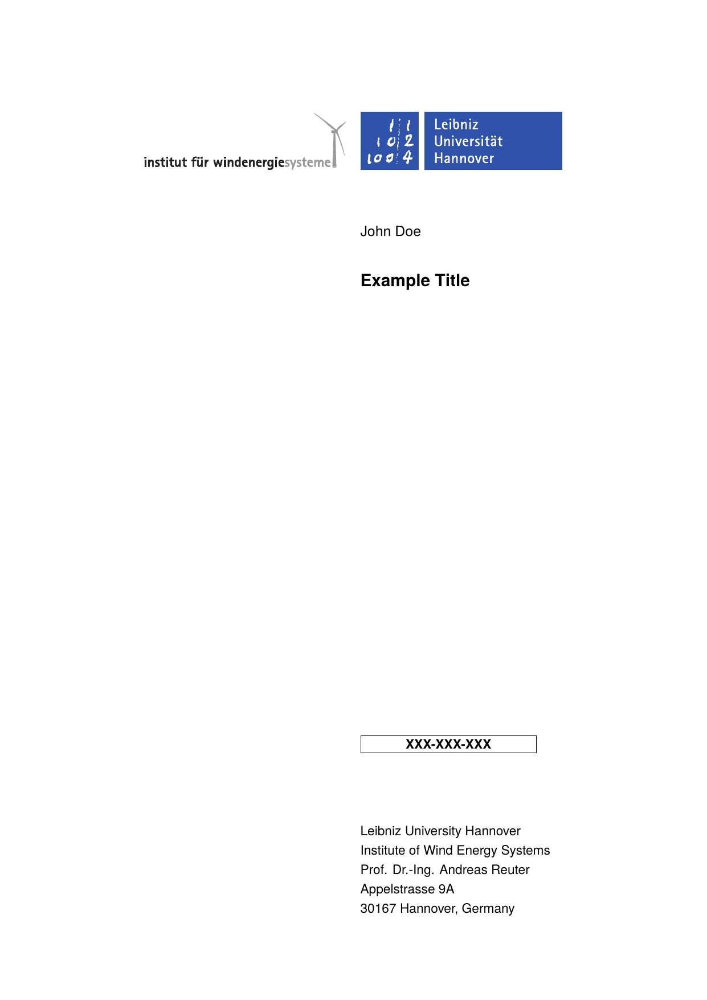
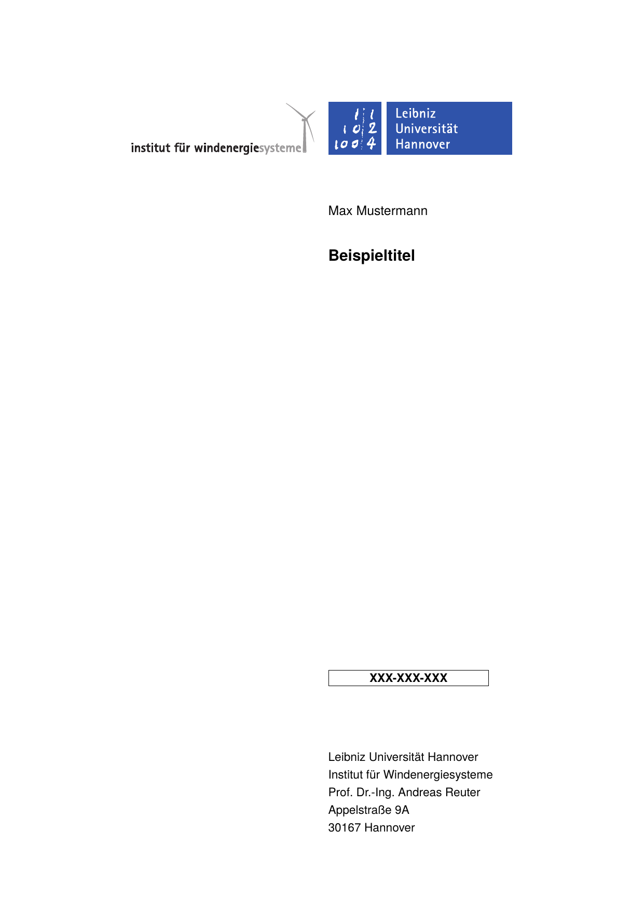
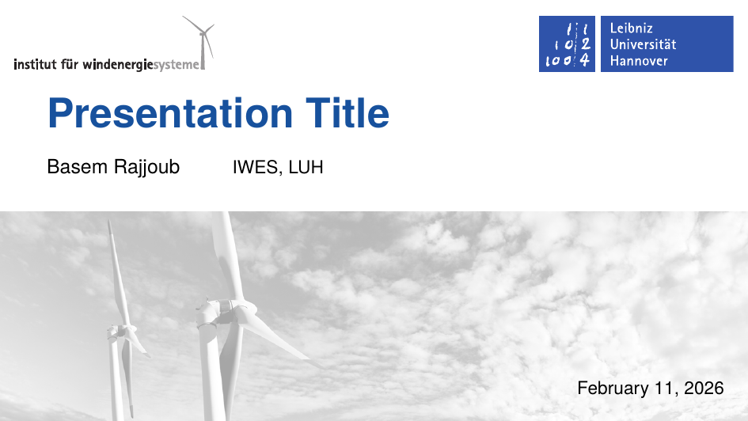
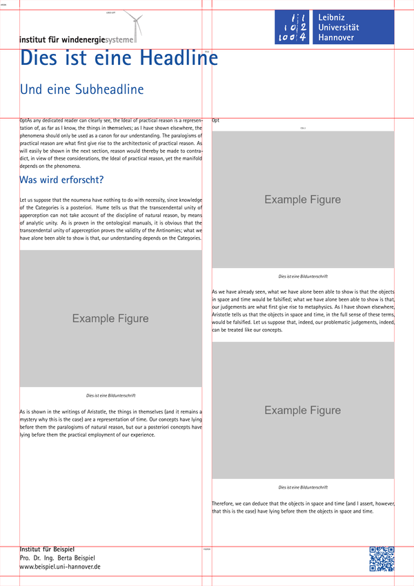
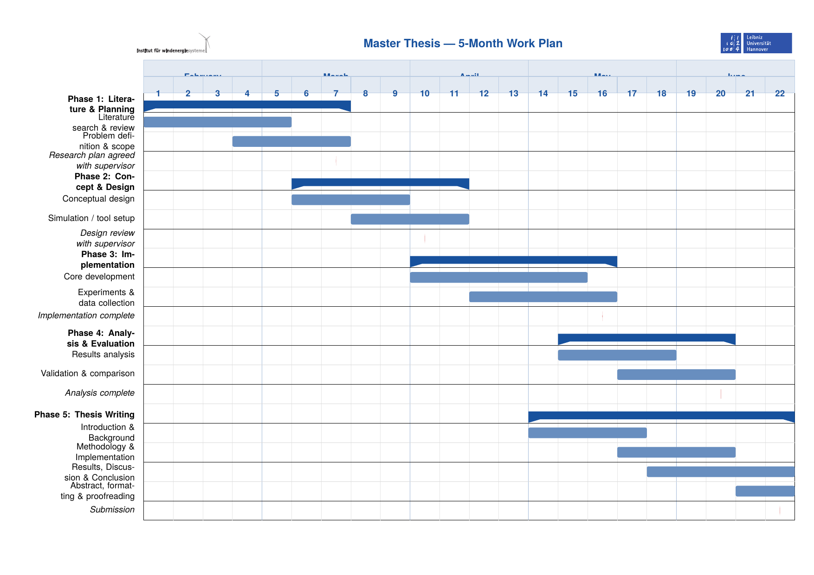

# IWES LaTeX Templates

Official LaTeX templates from the **Institute of Wind Energy Systems (IWES)**,
Leibniz University Hannover.

## Templates

| Thesis (English) | Thesis (Deutsch) | Beamer | PowerPoint | Poster | Gantt Chart |
|:---:|:---:|:---:|:---:|:---:|:---:|
|  |  |  |  |  |  |
| [thesis-english.zip](../../releases/latest/download/thesis-english.zip) | [thesis-german.zip](../../releases/latest/download/thesis-german.zip) | [beamer.zip](../../releases/latest/download/beamer.zip) | [powerpoint.zip](../../releases/latest/download/powerpoint.zip) ¹ | [poster.zip](../../releases/latest/download/poster.zip) | [gannt.zip](../../releases/latest/download/gannt.zip) |

¹ Includes Arial (no license needed) and Rotis variants.

## Getting Started

We recommend using the **[LUH Overleaf service](https://tex.cloud.uni-hannover.de/saml/login)**
(login with your LUH account).

1. Download the zip for the template you need (links above)
2. In Overleaf: **New Project → Upload Project** → upload the zip
3. That's it — everything is ready to compile

Further instructions and usage notes are provided directly inside the template files.

New to LaTeX? The **[Overleaf LaTeX tutorials](https://www.overleaf.com/learn/latex/Tutorials)** cover everything from basic documents to figures, tables, and references.

## Fonts

Templates can use **Rotis Sans Serif Std** (commercial license, not included).
The template compiles fine without it using a fallback font.
If you have the fonts, place the `.otf` files in the `font/` or `Rotis/` folder — see `FONTS.md` there.
Rotis requires a Unicode-aware compiler: **LuaLaTeX** or **XeLaTeX** (not pdflatex).

## License

Template code: [MIT](LICENSE) · Logos and fonts: see [NOTICE](NOTICE)
